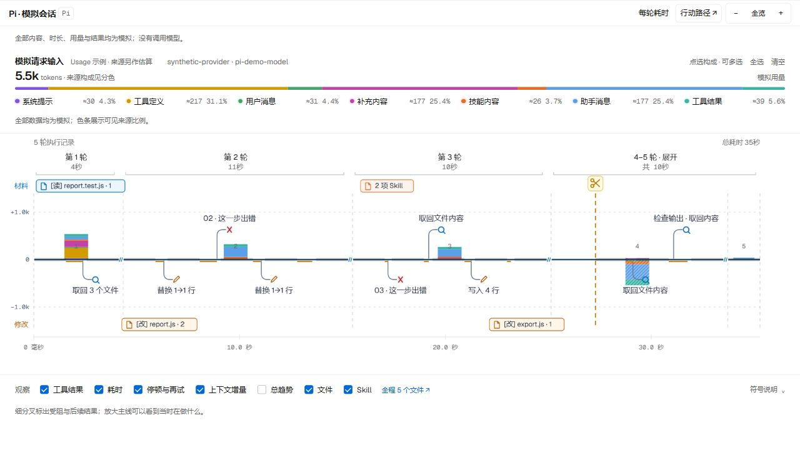
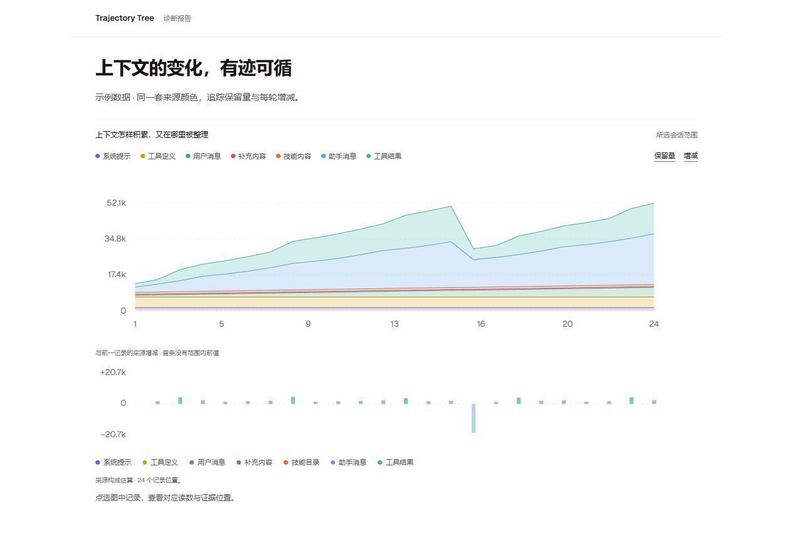
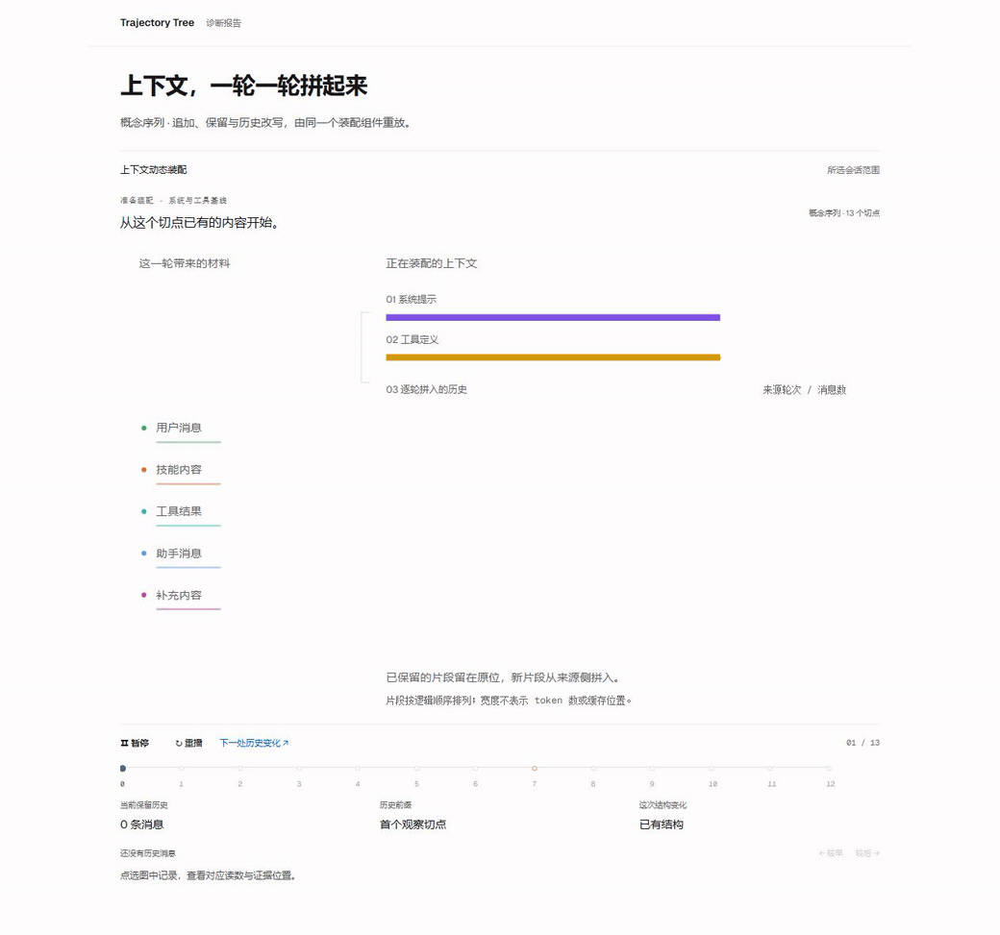
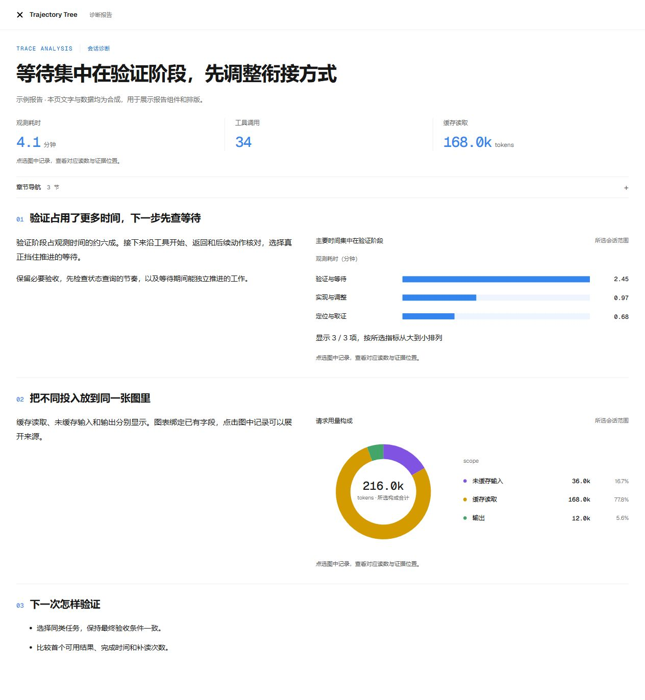

<h1 align="center">Trajectory Tree</h1>

<p align="center"><strong>See how your agent gets the work done.</strong></p>
<p align="center">Execution paths · Context changes · Tool evidence · Visual diagnosis reports</p>

<p align="center">
  <a href="README.md">中文</a> ·
  <a href="#quick-start">Quick start</a> ·
  <a href="docs/host-entrypoints.md">Host setup</a> ·
  <a href="LICENSE">MIT License</a>
</p>

<p align="center"><code>DSH</code> &nbsp; <code>Pi</code> &nbsp; <code>Codex</code> &nbsp; <code>Claude Code</code></p>



Start with the whole session, then open a turn to inspect arguments, results, file changes and feedback. Long conversations show the actual trunk first and fill in details progressively.

> Images and animation below use synthetic examples rendered by the project's existing views and report components.

## Follow context as it changes

Select one or more sources to follow their retained size and changes. Delta and total layers can coexist in the path view; **the total trend starts off and can be enabled when needed**.



## Watch context come together

Retained material stays in place, new content joins turn by turn, and historical rewrites identify the changed fragments. The same component can replay recorded structure inside a report.



## Read findings alongside their evidence

Bring findings, evidence and next actions into one report, using metrics, distributions, trends and original record locations. **The AI authors the report**; Markdown and chart components assemble into interactive HTML.



## Quick start

Run commands from the repository root. DSH plugins require Node.js 18+; other hosts and standalone views require Node.js 20+.

<details>
<summary><strong>DSH · Native plugins and analysis panel</strong></summary>

```sh
npm pack ./plugin/trajectory-tools
npm pack ./plugin/analysis-view
dsh plugin --profile web add ./dsh-trajectory-tools-0.6.0.tgz ./dsh-analysis-view-0.10.32.tgz
```

Restart `dsh web`, open Analysis, or use `/trajectory` for the current session's path. Stop an existing instance before restarting to avoid a port conflict.

Optionally add [Conversation search](plugin/conversation-search/README.md) for sidebar search and message navigation. DSH on-demand interpretation calls the current model. The post-compaction check-in is enabled by default; disable it with `config.reconcile: false`.

[Analysis panel](plugin/analysis-view/README.md) · [Evidence tools](plugin/trajectory-tools/README.md)

</details>

<details>
<summary><strong>Pi · Selected branch and native command</strong></summary>

```sh
npm ci --prefix plugin/portable-tools --ignore-scripts
pi -e ./plugin/portable-tools
```

Use `/trajectory` for the selected branch, `trace-analysis` for the session process, and `context-profile` for current context and tool configuration.

[Pi setup](plugin/portable-tools/README.md#pi)

</details>

<details>
<summary><strong>Codex · Plugin, MCP and standalone views</strong></summary>

```sh
npm ci --prefix plugin/portable-tools --ignore-scripts
node scripts/sync-host-skills.mjs
node scripts/package-trajectory.mjs --host codex
```

Install `dist/trajectory-tree-codex` from the local plugin directory, then use `$trajectory-view`, `$trace-analysis`, or `$context-profile`.

Generate a view directly for the current session; local session reads require the official `codex app-server`:

```sh
node scripts/trajectory-view.mjs --host codex --serve
```

[Plugin entry points](docs/host-entrypoints.md) · [Codex / MCP setup](plugin/portable-tools/README.md#codex)

</details>

<details>
<summary><strong>Claude Code · Native plugin and transcript</strong></summary>

```sh
npm ci --prefix plugin/portable-tools --ignore-scripts
node scripts/sync-host-skills.mjs
node scripts/package-trajectory.mjs --host claude
claude --plugin-dir ./dist/trajectory-tree-claude
```

Use `/trajectory-tree:trajectory-view`, `/trajectory-tree:trace-analysis`, or `/trajectory-tree:context-profile`. The plugin provides the current transcript path at session startup, resume and related lifecycle events.

[Claude Code setup](plugin/claude/README.md)

</details>

### Generate an offline view

```sh
node scripts/trajectory-view.mjs --host pi --file /absolute/session.jsonl --open
node scripts/trajectory-view.mjs --host claude --file /absolute/transcript.jsonl --open
```

Generation does not call a model. The command returns a standalone HTML file and a local preview URL; fonts are embedded for offline viewing.

## One set of evidence tools

| Tool | Purpose |
| --- | --- |
| `trajectory_inspect` | Inspect the process, latency, usage, repeated attempts, tools/files and context |
| `trajectory_search` | Locate sessions, literal records and statistical scopes |
| `trajectory_read` | Read originals, connected actions and feedback; continue through full arguments and results |
| `trajectory_graph` | Inspect record relations and session lineage |

Queries are read-only. Each host exposes its recorded evidence; missing content remains unknown.

| Host | Main data sources |
| --- | --- |
| DSH | Native events, official statistics, context composition, files, Skills and subagents |
| Pi | Selected branch, current SDK configuration and captured execution timing |
| Codex | Official session APIs and matching local thread records |
| Claude Code | An explicitly selected transcript, native tool arguments/results and recorded message usage |

## Documentation

- [Host setup and commands](docs/host-entrypoints.md)
- [Tool configuration, queries and continued reads](plugin/portable-tools/README.md)
- [Analysis methods](skill/trace-analysis/SKILL.md) · [Context and configuration profile](skill/context-profile/SKILL.md)
- [HTML report components](report/AUTHORING.md)

<details>
<summary>Development and checks</summary>

```sh
node scripts/sync-host-skills.mjs --check
node scripts/sync-view-assets.mjs --check
npm test --prefix plugin/trajectory-tools
npm test --prefix plugin/portable-tools
node plugin/analysis-view/presentation-test.mjs
node plugin/analysis-view/perf-test.mjs
```

`plugin/` provides host integrations, `analyzers/` reads native records, and `view/` plus `report/` provide visualizations. Recreate the public showcase pages with `node scripts/build-readme-media.mjs --serve 3099`.

</details>

## License

[MIT](LICENSE) © 2026 goatliamia
